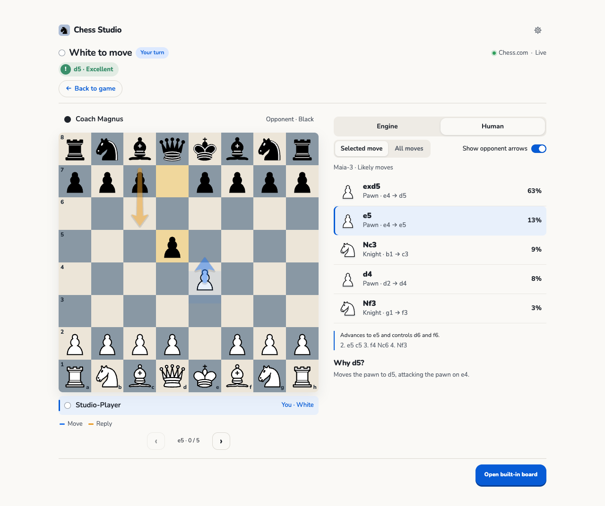
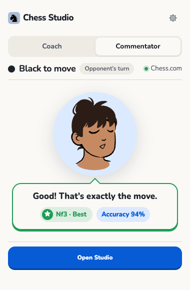
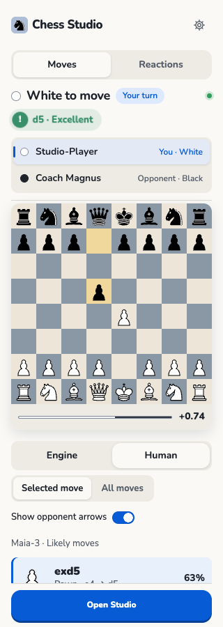
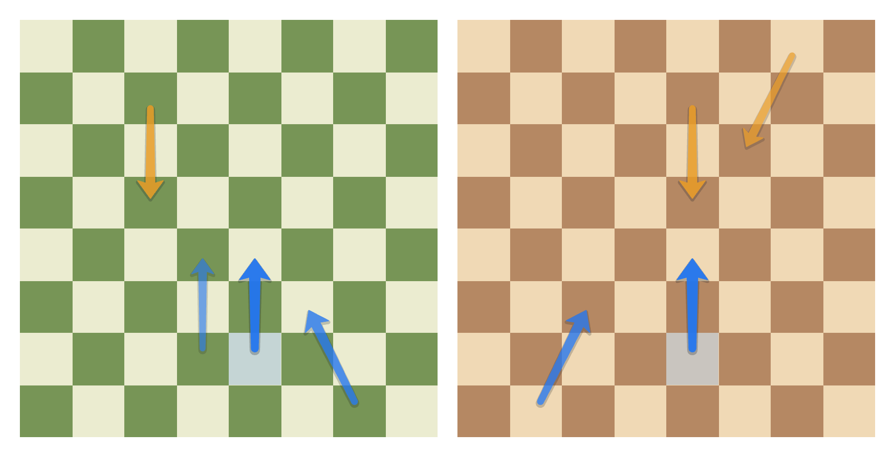

# Chess Studio

[](https://github.com/FL-spec/chess-studio/releases)
[](extension/manifest.json)
[](LICENSE)

A free Chrome extension for learning chess: Stockfish 19 and the Maia-3 human model, running on your own computer, beside your Chess.com or Lichess board.

**[Install](#install) · [Usage](#usage) · [How it works](#how-it-works) · [Privacy](#privacy) · [Development](#development)**

<p align="center">
  
</p>

Chess Studio follows the board you are playing or analysing, shows the strongest moves and the moves a human at your level would most likely play, and draws them as arrows on the board. It also has its own board for practice games and PGN review. Every feature works without an account, and all analysis runs locally.

## Features

- **Engine lens.** The full Stockfish 19 NNUE build ranks candidate moves with MultiPV, with depth and candidate count controls and an evaluation bar.
- **Human lens.** Maia-3, a neural model from the University of Toronto's CSSLab, predicts the moves players at a chosen rating are most likely to make. On 240 positions from Lichess games it ranked the played move first 53.8% of the time ([details](docs/product.md#model-selection-and-verification--150)).
- **Board arrows.** Turn-aware arrows on supported Chess.com and Lichess pages. Blue arrows show the first move, amber arrows show the expected reply.
- **You and your opponent.** On Chess.com, the signed-in username labels the players. Pick a player to keep their moves in the list as turns change.
- **Move grades and reactions.** Each move you play gets a grade from Best to Blunder, with a streak and accuracy. Switch the panel from **Coach** to **Commentator** to hide suggestions and get short comments on your moves instead. The opponent's moves get a comment only when they are very bad or very good.
- **Three views.** A pop-out window, a panel pinned in Chrome's side panel, and Studio, a full workspace with replay controls.
- **Practice.** Play as White or Black against a local opponent, with or without hints.
- **Game review.** When a game ends, the panel shows the result and an **Open in Studio** button. It opens a clean review of the whole game: accuracy, grade counts, an evaluation graph, the move list with grade icons, and the coach explaining each move.
- **Commentator in Studio.** The same coach comments in Studio: on your moves in Practice, on every move in Review, and on your attempt when you retry a position. For a move that was not the best, it names the best move and can show it on the board.
- **Review.** Load a PGN or FEN, compare the played move with Stockfish's best line, find turning points, and replay a position with hints hidden.
- **Library.** Save positions and games locally and export them as PGN.

| Commentator | Pinned panel | Arrows on the board |
| --- | --- | --- |
|  |  |  |

## Install

Chess Studio needs Chrome 116 or later.

### From a release

1. Download `Chess-Studio-<version>.zip` from the [releases page](https://github.com/FL-spec/chess-studio/releases) and extract it.
2. Open `chrome://extensions` and turn on **Developer mode**.
3. Click **Load unpacked** and choose the extracted folder that contains `manifest.json`.
4. Pin **Chess Studio** from Chrome's Extensions menu.

### From source

```bash
git clone https://github.com/FL-spec/chess-studio.git
```

Then follow steps 2 to 4 above and choose the `extension` folder of the clone.

Reload any Chess.com or Lichess tab that was already open when you installed the extension.

## Usage

Click the toolbar icon and pick a view:

| View | What it is |
| --- | --- |
| **Pop out** | A floating window with the move list and evaluation bar. |
| **Pin analysis** | The same view in Chrome's side panel, next to the game. |
| **Open Studio** | A full tab with a board, replay controls, Practice, Review and Library. |

The popup and side panel follow the most recently active workspace. Keep the workspace tab open to see move-by-move updates.

### Follow a game

1. Open a supported board: Chess.com Play Coach, a computer or standard game (localized URLs included), Chess.com Analysis, Lichess Analysis, or a Lichess game page.
2. Open a view. It names the source board and shows the side to move.
3. Choose **Engine** for Stockfish's strongest lines or **Human** for the most likely moves at the selected skill level.

The move list follows the turn until you click a player. When the selected player moves second, the list shows the first move their replies depend on. Click a move to draw that reply. **All moves** draws several candidates at once. In Studio, step through the selected line and use **Back to game** to return to the source tab. **Settings → Board arrows follow** switches between turn-following, turn-only and selected-player arrows.

On other chess websites, choose **Website analysis** in the pop-out and select **Read this tab**. This uses temporary page access and reads one visible, complete FEN position. For boards that only draw pieces, paste the PGN or FEN into Review.

### Practice and review

- **Practice.** Click two squares, drag a piece, or use the arrow keys and Enter. **Show lines** runs Stockfish while you play.
- **Review.** **Compare played move** checks a move against Stockfish's best line. **Find turning points** scans the first 100 plies. **Try the position** lets you replay a move with hints hidden.
- **Settings.** One page holds the default lens, depth, candidate count, model skill, explanations, arrow behavior and appearance.

Stockfish scores use the side-to-move perspective. Move explanations describe observable changes on the board.

## How it works

```text
Chess.com / Lichess tab                  Extension views
┌──────────────────────────┐            ┌─────────────────────────────┐
│ detect.mjs  site adapters│──position──▶ popup · side panel · Studio │
│ board-mark  arrow overlay│◀──arrows───│                             │
└──────────────────────────┘            └──────────────┬──────────────┘
                                                       │
                              ┌────────────────────────┴───────────────┐
                              │ Stockfish 19 worker   Maia-3 worker    │
                              │ (WASM, NNUE)          (ONNX Runtime)   │
                              └────────────────────────────────────────┘
```

- **Detection adapters** (`detect.mjs`, `detect-entry.js`, `read-fen.js`) read the position from the page. Each adapter checks the visible pieces against a readable position, a replayed move list or a unique legal transition. Unsupported pages clear stale recommendations.
- **Overlay** (`board-mark.mjs`) draws arrows on the site's board and removes them when the position changes.
- **Engine** (`engine.mjs`, `engine-core.mjs`) runs the single-threaded Stockfish 19 WebAssembly build in a worker. Single-threaded WASM works without cross-origin isolation. One engine runs in an offscreen document shared by the pop-out, the pinned panel and Studio, with shared searches and a per-position cache (`engine-host.mjs`).
- **Human model** (`maia.mjs`, `maia-worker.js`) runs Maia-3 with ONNX Runtime Web in a worker. It mirrors Black's board into the model's coordinates, uses the selected skill as both players' rating, and normalizes the output over legal moves. A smaller built-in model (`policy.mjs`, `weights.mjs`) is used when Maia-3 is unavailable or selected in Settings.

The [product notes](docs/product.md) cover the design and the model comparison. The [performance review](docs/performance.md) covers engine reuse, caching and board tracking.

## Privacy

Chess Studio has no account, server, analytics or telemetry. Board positions and player names stay in your browser.

- Stockfish and the built-in human model ship with the extension.
- The first use of Maia-3 downloads the 46 MB model directly from CSSLab's GitHub repository. The extension checks it against a pinned SHA-256 digest and caches it locally. Nothing is sent with the request.
- The extension never plays moves on a website.
- **Read this tab** uses Chrome's `activeTab` permission, which lasts only for that tab and visit.

## Development

The tests drive the unpacked extension in a real browser with Playwright Core. You need Node.js 20 or later and a Chrome for Testing or Chromium build that can load unpacked extensions.

```bash
cd development
npm install
CHESS_TEST_CHROME=/path/to/chrome npm test
```

`npm test` runs the policy, detector and engine tests, then the Studio and website smoke tests.

To build the release ZIP from the extension folder:

```bash
scripts/package.sh
```

It writes `dist/Chess-Studio-<version>.zip`, with the version taken from `manifest.json`.

The built-in human model was fitted to 6,500 rated games from the [Lichess January 2013 CC0 export](https://database.lichess.org/standard/lichess_db_standard_rated_2013-01.pgn.zst). To retrain it, run this from `development/`:

```bash
zstd -dc /path/to/corpus.pgn.zst | node train.mjs
```

`model-eval.cjs` reproduces the Maia-3 comparison; see [docs/product.md](docs/product.md). Read [CONTRIBUTING.md](CONTRIBUTING.md) before opening a pull request.

## Project structure

```text
extension/         the extension (load this folder in Chrome)
  vendor/          chess.js, Stockfish 19, ONNX Runtime Web
  pieces/          cburnett piece set
development/       tests, benchmarks, model training and evaluation
docs/              product notes, performance review, UI audit, images
scripts/           release packaging
```

## Limitations

- Automatic detection and arrows cover Chess.com standard boards on the routes listed above, Lichess Analysis and Lichess game pages. Other sites need **Read this tab** or a pasted PGN or FEN.
- The skill setting is a model input. It does not certify a playing rating.
- Human continuations are model predictions, and engine results can change with depth.

## Credits

Chess Studio builds on [Stockfish](https://stockfishchess.org/) through [stockfish.js](https://github.com/nmrugg/stockfish.js), [Maia-3](https://github.com/CSSLab/maia-platform-frontend) by CSSLab, [chess.js](https://github.com/jhlywa/chess.js), [ONNX Runtime Web](https://github.com/microsoft/onnxruntime), and the cburnett pieces distributed by [Lichess](https://github.com/lichess-org/lila). Versions and licenses are listed in [THIRD_PARTY_NOTICES.md](THIRD_PARTY_NOTICES.md).

## License

Chess Studio is licensed under the [GNU General Public License v3.0 or later](LICENSE), because it bundles GPL-licensed Stockfish and piece artwork.
